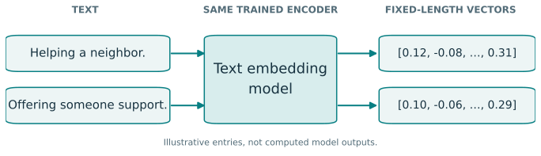
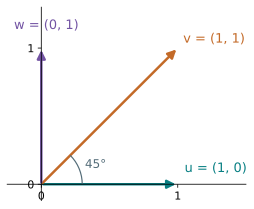
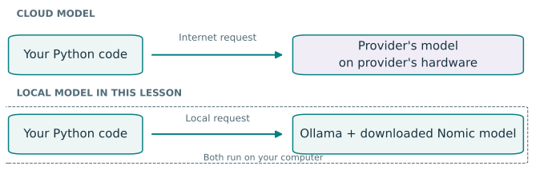

## Why do we do EDA?

We explore data to understand what it contains, investigate questions, and discover what to examine next.

Think of the Titanic or tornado investigation:

**What did a useful new plot help you notice or ask?**

::: {.notes}
0:00-1:30 including title. Take one or two short contributions. Examples: compare proportions rather than counts, reveal a relationship, identify an unusual observation, or check an explanation. Emphasize that a question guides the next operation and the result can change the question. This is a bridge from the earlier work, not an isolated quiz about embedding interpretation.
:::

## Why did dimensionality reduction help?

One observation can have many numerical features.

Dimensionality reduction gives us a small number of coordinates for a view of those observations.

Color and the original data help us interpret the view.

**What information might a two-dimensional view leave out?**

::: {.notes}
1:30-2:30. Recall how a passenger's many prepared features became two plotted coordinates. A map compresses information, so we still investigate original observations. Keep this review conceptual; the focus today is applying the familiar workflow to text. Students should recognize the familiar role of a feature matrix.
:::

## What if an observation is a piece of text?

“Helping a neighbor through a difficult time.”

We can read the words, but what numbers should describe the observation?

We want to investigate which messages express related ideas, even when their wording differs.

::: {.notes}
2:30-3:30. Ask for one idea, such as word counts or word indicators, but do not start another text-processing lesson. Motivate a learned representation as one option. The same EDA question now needs a different way to construct features.
:::

## A model turns text into a vector

{width="100%"}

Related texts can have similar vectors. Individual coordinates usually do not have convenient topic names.

::: {.attribution}
Simplified redraw of Reimers & Gurevych (2019), *Sentence-BERT*, Fig. 2: [paper](https://arxiv.org/abs/1908.10084), [CC BY-SA 4.0](https://creativecommons.org/licenses/by-sa/4.0/). Architecture details omitted; this is not Nomic's exact architecture.
:::

::: {.notes}
3:30-5:00. One input string becomes one fixed-length vector. The model has been trained previously; we are applying it rather than training it in class. The two uses of the encoder share the same trained model. The illustrative numbers help show the type and shape of the output, not an actual model result. Explain that an embedding is a representation, not a generated prose answer and not a list of named topics. The redraw removes SBERT-specific architecture details and the similarity-computation node to focus on text-to-vector conversion.
:::

## Predict before computing

1. Helping a neighbor through a difficult time.
2. Offering support to someone facing hardship.
3. The train arrives at the station at noon.
4. Refusing to help a neighbor through a difficult time.

Which pair should be most similar? Which comparison might challenge the model?

::: {.notes}
5:00-6:30. Give students a short partner discussion. Sentences 1 and 2 express related ideas with different words; sentence 4 tests negation despite shared wording. Do not promise a particular model score or ranking. The notebook later computes actual Nomic results so we can compare the prediction with the evidence.
:::

## Comparing two vectors

Cosine similarity compares their directions:

$$
\operatorname{cosine}(u,v)=\frac{u^\top v}{\|u\|_2\|v\|_2}
$$

Same direction: **1**. Perpendicular: **0**. Opposite directions: **-1**.

The score is a comparison under this representation, not a probability of identical meaning.

::: {.notes}
6:30-7:30. The formula requires nonzero vectors. Connect the dot product and vector norm to linear algebra. We will use a familiar two-coordinate example before considering hundreds of coordinates. A high score cannot by itself establish that two statements make the same claim, especially with negation.
:::

## A two-dimensional example {.cosine-slide}

{width="64%"}

$$
\operatorname{cosine}((1,0),(1,1))=\frac{1}{\sqrt{2}}\approx0.707
$$

What is the similarity between **u** and **w**?

::: {.notes}
7:30-9:30. Work the numerator 1*1+0*1=1 and lengths 1 and sqrt(2). The second answer is 0. Ask what would happen for (-1,0), giving -1. These are deliberately simple geometric vectors, not a projection of Nomic features. The completed notebook includes the same calculation with NumPy, so students can inspect every operation.
:::

## Where does the model run?

{width="100%"}

Cloud services supply the computing hardware. Local use requires a downloaded model and suitable hardware on your computer.

::: {.notes}
9:30-11:00. Students have mostly encountered cloud models. Both approaches can be called from Python. In this lesson a cloud request crosses the computer boundary; the local request goes to a service on the same computer. Avoid claiming that all cloud systems or all local systems have identical privacy/performance properties. After the initial download, this lesson's local inference uses the downloaded model. Ollama also has cloud features; we are demonstrating its local path. Source: https://docs.ollama.com/faq.
:::

## Ollama runs the model for us

- **Ollama application:** downloads and runs models.
- **Nomic model:** supplies the learned text-to-vector transformation.
- **Python package:** lets our notebook request embeddings.

Install the application, start it, and download the model before class. Installing the Python package alone does not start the application.

::: {.notes}
11:00-12:00. Connect the local service to the earlier client/server and API material. The notebook is the client. The Ollama application serves requests, normally on localhost:11434. No cloud API key is needed for this downloaded model. Students should distinguish the serving tool from the trained model and its Python interface. Source: Ollama documentation.
:::

## Our model: nomic-embed-text:v1.5

A pretrained text embedding model available through Ollama.

- Returns a numerical vector rather than a chat response.
- Normally produces **768 values** per input; inspect the actual result.
- Uses a task prefix. We will consistently use **`clustering: `** for grouping similar messages.

::: {.small}
[Nomic model card](https://huggingface.co/nomic-ai/nomic-embed-text-v1.5) · [Ollama model](https://ollama.com/library/nomic-embed-text:v1.5)
:::

::: {.notes}
12:00-13:00. The prefix is part of the input convention documented by Nomic; it does not perform a clustering analysis. Use the same model and prefix for phrases and kickers. Distinguish model embedding dimensions from the later two-dimensional visualization. Avoid a long model benchmark comparison or architecture discussion.
:::

## Ask for an embedding

```python
import ollama

response = ollama.embed(
    model="nomic-embed-text:v1.5",
    input="clustering: Helping a neighbor.",
    truncate=False,
)
vector = response["embeddings"][0]
```

We will inspect the response, the vector length, and a few values before doing anything more complicated.

::: {.notes}
13:00-14:00. The endpoint can return several embeddings, so a single input still gives an outer list; [0] selects its first vector. truncate=False makes overlong inputs an explicit error. Do not unpack a complicated helper function or introduce batch caching here. The next step in the notebook repeats the same visible call for a few phrases. Source: https://docs.ollama.com/api/embed.
:::

## Continue in the demonstration notebook

Open **`demo_live.ipynb`** in Positron.

We will build:

**A phrase → one kicker → all kickers → a feature matrix → PHATE → plots that help answer a question.**

Keep **`demo_complete.ipynb`** available as a reference.

::: {.notes}
14:00-15:00. End the slide deck here. Continue all remaining teaching, plotting, interpretation, filtering-versus-refitting, and the closing discussion in the notebook. Use the question about similar highlighted messages and their years/recorded roles to motivate each added plotting argument. Student investigation is in practice.ipynb, with its setup clearly separated from instructor code.
:::
